# Contre-audit Arya Access #1 — état avant/après

Suivi des points relevés par le contre-audit RGAA 4.1 d'Arya Access (grille `grille_conformite_RGAA_4.1_ARYA.ods`, échantillon mis à jour P01→P10). État "avant" capturé en direct sur la prod (`conseiller-numerique.gouv.fr` et `candidature.conseiller-numerique.gouv.fr`) le 19/10/2026 avant tout déploiement ; état "après en prod" confirmé le même jour après déploiement des PR #38, #39 (site-vitrine-conum) et #360, #361 (site-vitrine).

Légende : **NC** = non-conformité relevée par le contre-audit · **Remarque** = point d'attention sur un critère déjà jugé conforme (facultatif).

---

## site-vitrine-conum

### 1.2 — Logo décoratif non ignoré, Accueil (NC mineur — déjà corrigé, PR #38)

**Avant (prod) :** ``, pas de `aria-hidden`.

**Après (vérifié en local sur la branche) :** `alt=""` + `aria-hidden="true"`.
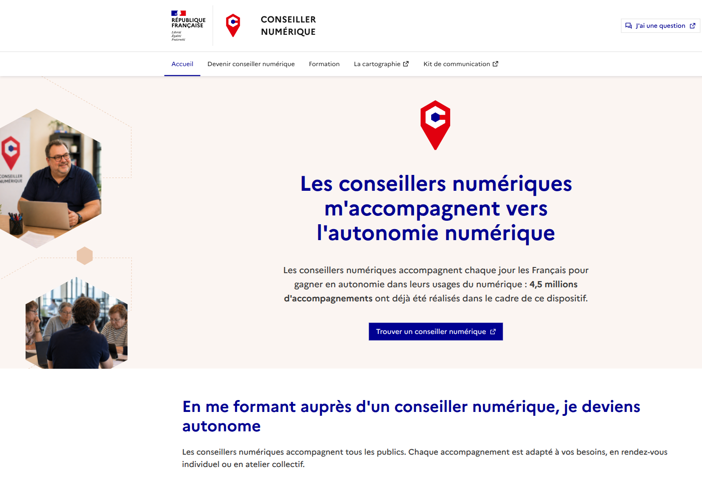

**Après en prod :** confirmé — `alt=""` + `aria-hidden="true"` sur le logo.

---

### 8.9 — Lien "Demander le label" non masqué pour les technologies d'assistance (remarque sur critère conforme)

**Avant (prod) :** le composant `Header` (DSFR) génère un `<li>` par élément de `quickAccessItems`. La classe `tmpLabelHidden` (`display:none !important`) est posée sur le `<a>` "Demander le label", pas sur le `<li>` englobant — contrairement au lien de nav "Le label" où `tmpLabelHidden` est bien sur le `<li>` (`fr-nav__item tmpLabelHidden`). Le `<li>` du header reste donc dans la liste (`display:flex`/`list-item`), ce qui peut être compté par certaines technologies d'assistance même si son contenu est invisible.
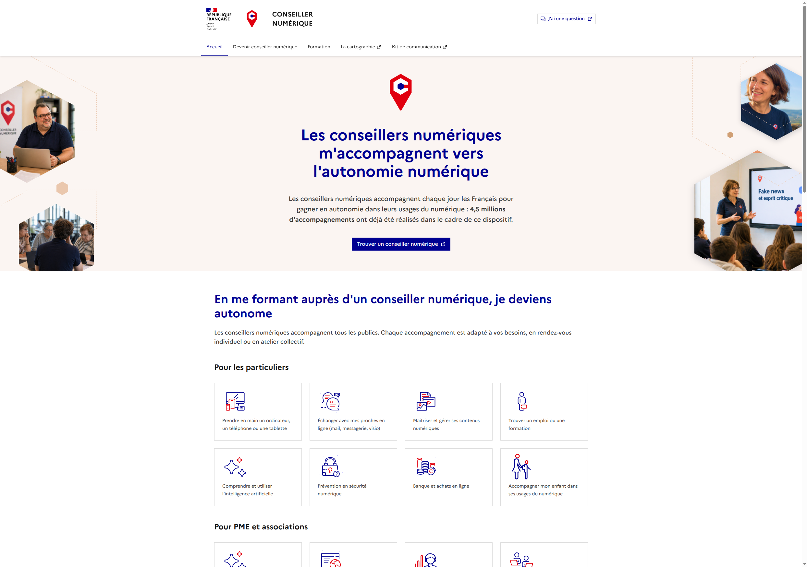

**Correctif :** règle CSS générique `li:has(> .tmpLabelHidden) { display: none !important; }` dans `globals.css` (le composant Header DSFR n'expose pas de className sur le `<li>` généré).

**Après (vérifié en local) :** le `<li>` passe à `display:none`.
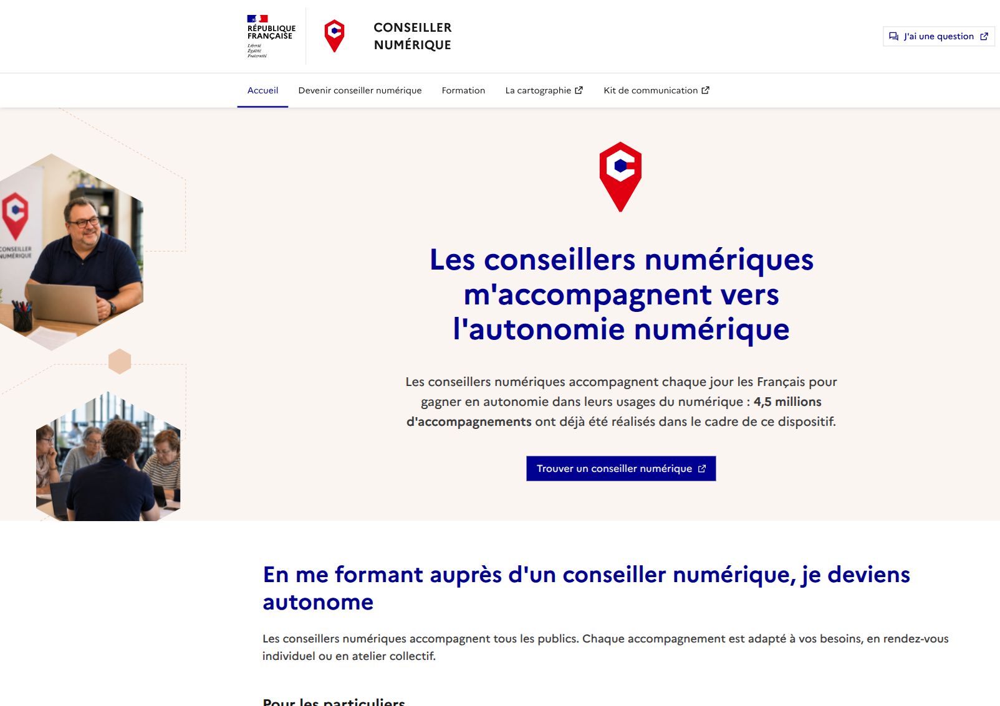

**Après en prod :** confirmé — le `<li>` passe à `display:none`.

---

### 3.2 — Contraste du hero à largeur intermédiaire (remarque sur critère conforme)

**Avant (prod) :** non reproduit. Testé à 1100, 1250, 1281, 1300px (avec et sans simulation RGAA de l'espacement de texte) : les images décoratives (`hero-decor-gauche.svg` / `hero-decor-droite.svg`, 299px de large, visibles à partir de 80em/1280px) gardent une marge confortable (>150px) avec le bloc de texte centré (`max-width: 45rem`), aucun chevauchement ni perte de contraste observés.
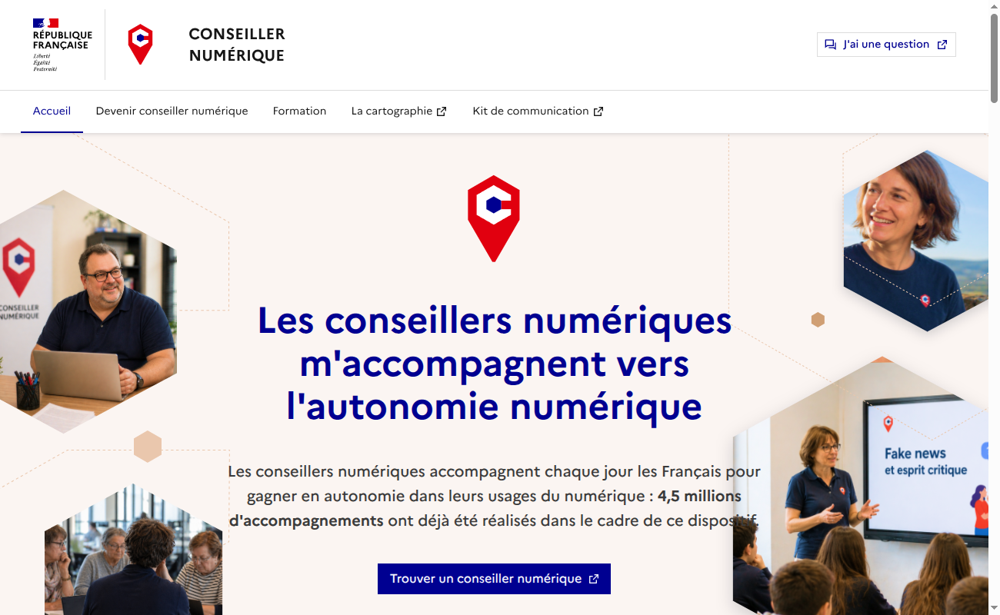

**Conclusion :** point probablement déjà résolu par un correctif antérieur (dimensions fixes → min/max, #7) ou lié à un rendu spécifique au poste de l'auditeur. Pas de correctif de code prévu ; à signaler tel quel à l'auditeur pour qu'il confirme sur sa repasse.

---

### 6.1 — Lien "En savoir plus" peu explicite (remarque sur critère conforme), Accueil

**Avant (prod) :** texte visible "En savoir plus", complété par un texte `sr-only` (" sur comment devenir conseiller numérique") donnant un nom accessible déjà explicite : *"En savoir plus sur comment devenir conseiller numérique"*. Conforme techniquement (statut C), l'auditeur suggère de rendre le texte **visible** lui-même plus explicite.
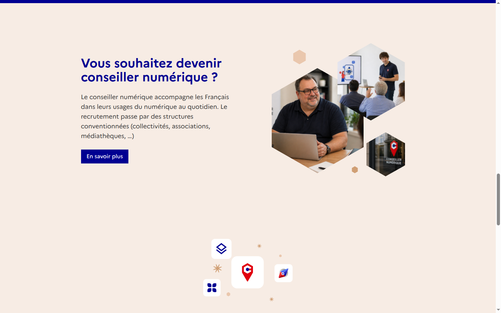

**Après (vérifié en local) :** texte visible remplacé par "Devenir conseiller numérique" (le `sr-only` devenu redondant est retiré).

**Après en prod :** confirmé — lien "Devenir conseiller numérique".

---

### 6.1 — Liens "Garanties" peu explicites (remarque sur critère conforme), CGU

**Avant (prod) :** dans le tableau "Sous-traitants de la plateforme", les liens de la colonne Garanties affichent l'URL brute comme texte (ex. "clever-cloud.com/en/security", "fr.sendinblue.com/rgpd", "scalingo.com/fr", "pix.fr/politique-protection-donnees-personnelles-app").
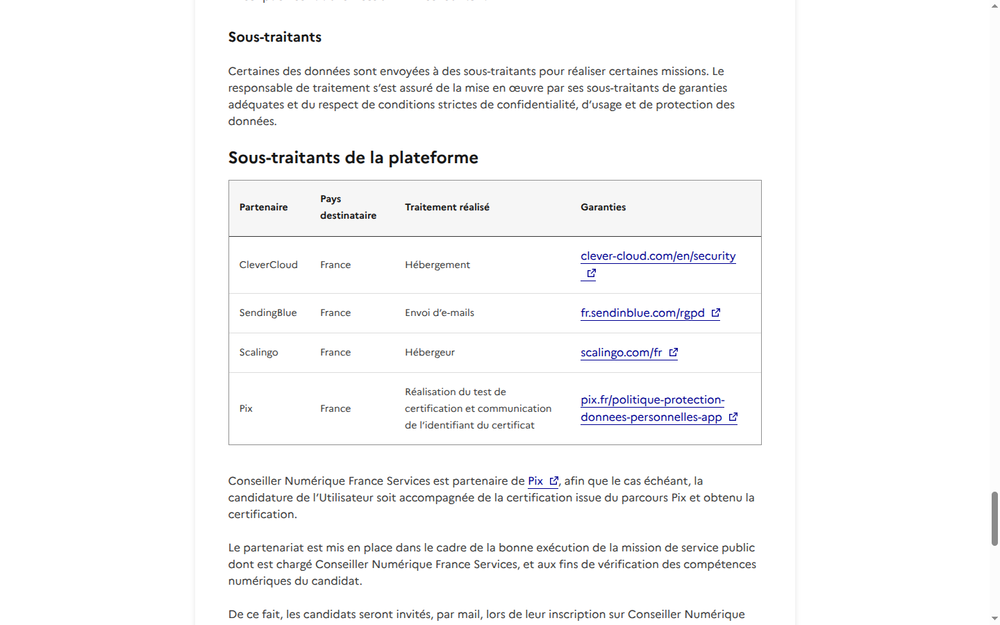

**Après (vérifié en local) :** "Voir les garanties de [partenaire]" pour les 4 liens.
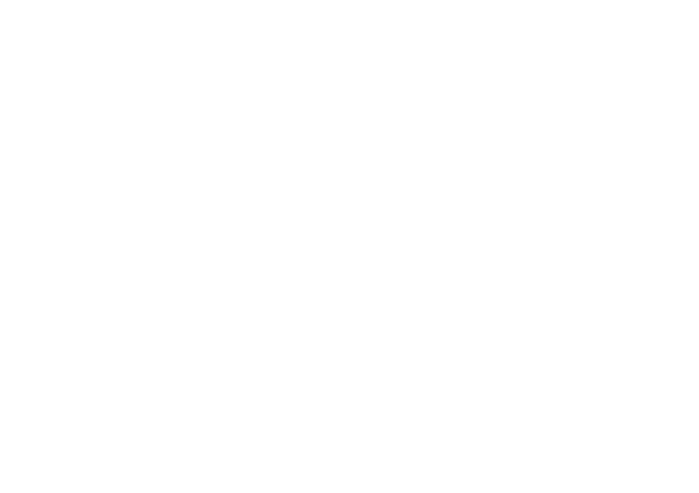

**Après en prod :** confirmé — "Voir les garanties de CleverCloud/SendingBlue/Scalingo/Pix" pour les 4 liens.

---

## site-vitrine (formulaire de candidature conseiller)

### 11.2 — Format de date manquant dans l'étiquette (NC majeur, partiel — déjà corrigé, PR #360)

**Avant (prod) :** étiquette du champ date sans indication de format.
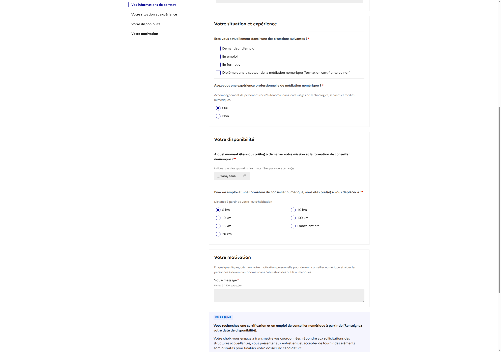

**Après (vérifié en local) :** "... Format : 10/10/2010." ajouté au texte d'aide.
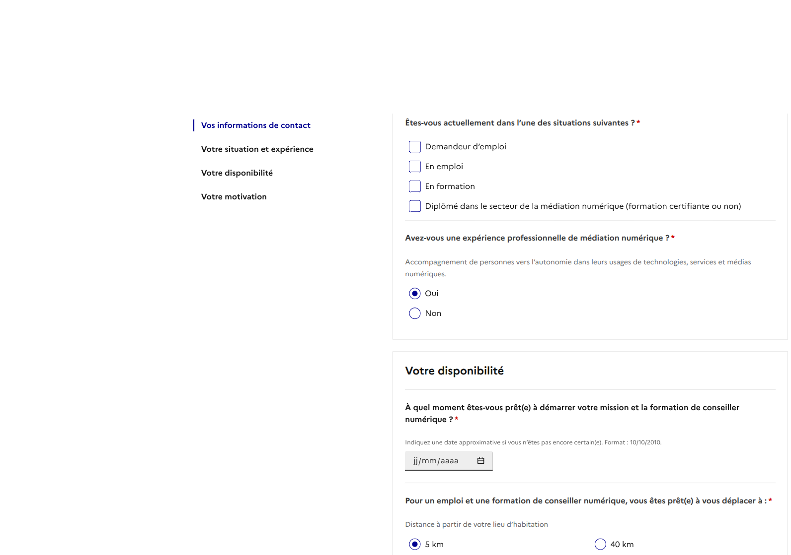

**Après en prod :** confirmé — "... Format : 10/10/2010." présent dans le texte d'aide.

---

### 11.13 — Autocomplete manquant sur "Lieu d'habitation" (NC mineur, partiel — déjà corrigé, PR #360)

**Avant (prod) :** `autoComplete="off"` sur le champ `lieuHabitation`.
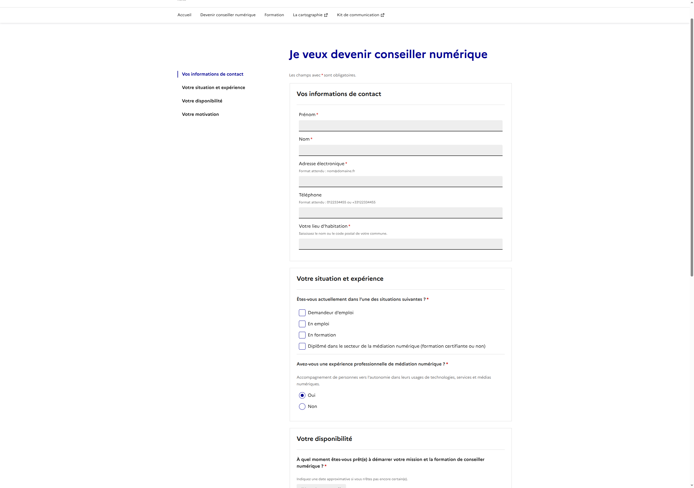

**Après (vérifié en local) :** `autoComplete="postal-code"`.

**Après en prod :** confirmé — `autoComplete="postal-code"`.

---

### 9.1 — Blocs de formulaire structurés en `<fieldset><legend>` au lieu de titres (NC majeur, nouveau)

**Avant (prod) :** les 4 sections du formulaire ("Vos informations de contact", "Votre situation et expérience", "Votre disponibilité", "Votre motivation") sont des `<legend>` de `<fieldset>`, pas des titres de niveau 2.
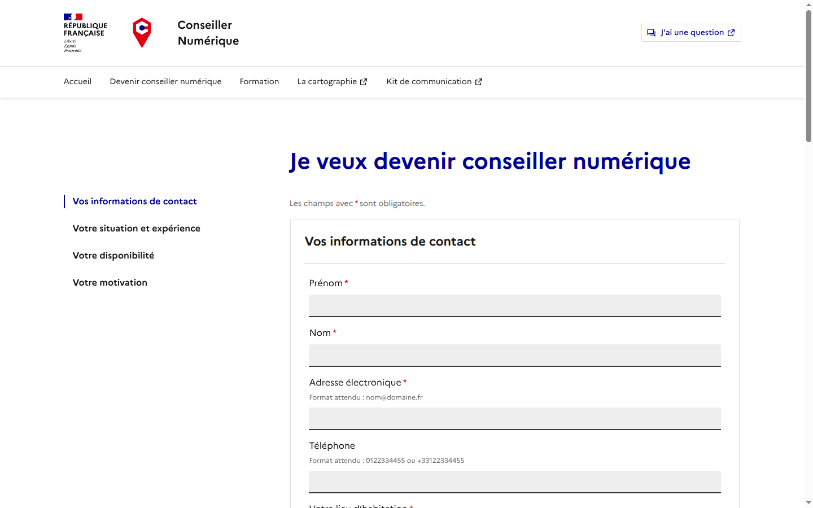

**Correctif :** `<fieldset>`/`<legend>` remplacés par `<section aria-labelledby="...">`/`<h2>` sur les 4 sections (`InformationsDeContact.jsx`, `SituationEtExperience.jsx`, `Disponibilite.jsx`, `Motivation.jsx`). Les `id` d'ancrage du sommaire sont conservés sur les `<section>`. Nettoyage du hack CSS `float:left` qui ne s'appliquait qu'au rendu particulier de `<legend>`.

**Après (vérifié en local) :** 4 titres de niveau 2, structure `h1 > h2×4` sans saut de niveau.
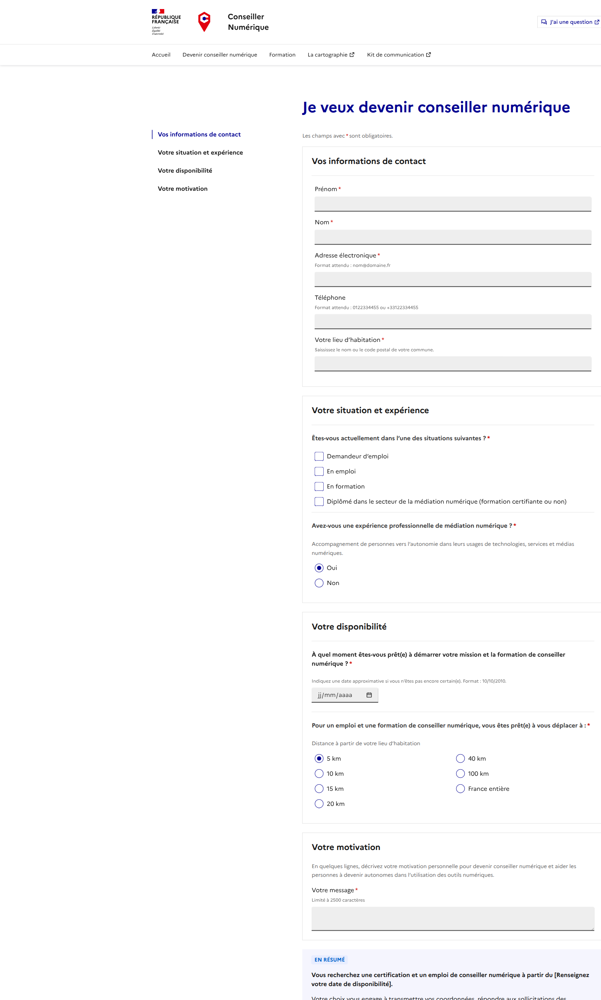

**Après en prod :** confirmé — 4 `<h2>` ("Vos informations de contact", "Votre situation et expérience", "Votre disponibilité", "Votre motivation").

---

### 9.2 — Balise `<main>` manquante (NC mineur, nouveau)

**Avant (prod) :** `document.querySelector('main')` → `null`, le corps de la page n'est contenu dans aucune balise `<main>`.

**Correctif :** `<Routes>` encapsulé dans `<main>` au niveau de `App.js` — corrige la zone de contenu principal sur toutes les pages de l'application (candidature conseiller, structure, coordinateur, confirmations), pas seulement P06.

**Après (vérifié en local) :** `document.querySelector('main')` non nul.

**Après en prod :** confirmé — `<main>` présent.

---

### 10.10 — `aria-current="page"` au lieu de `"location"` sur l'ancre active du sommaire (NC mineur, nouveau)

**Avant (prod) :** l'ancre active du sommaire latéral porte `aria-current="page"`.

**Correctif :** `components/Sommaire.jsx` (composant partagé par les 3 formulaires) — `aria-current="location"`.

**Après (vérifié en local) :** `aria-current="location"`.

**Après en prod :** confirmé — `aria-current="location"`.

---

### 12.6 — `role="navigation"` manquant sur le `<nav>` du sommaire (NC mineur, nouveau)

**Avant (prod) :** le `<nav class="fr-sidemenu" aria-label="Sommaire">` n'a pas d'attribut `role="navigation"` explicite (seul le rôle implicite HTML5 est présent). Le `<nav>` du menu principal (`fr-nav`), lui, a déjà `role="navigation"` explicite.

**Correctif :** `role="navigation"` ajouté sur `components/Sommaire.jsx`.

**Après (vérifié en local) :** `role="navigation"` présent.

**Après en prod :** confirmé — `role="navigation"` présent.

---

## Hors périmètre (rappel)

- **2.2** et **8.9** (captcha Cloudflare Turnstile — titre "Widget", texte "Succès !" en ``) : exclus, widget tiers non modifiable de notre côté.
